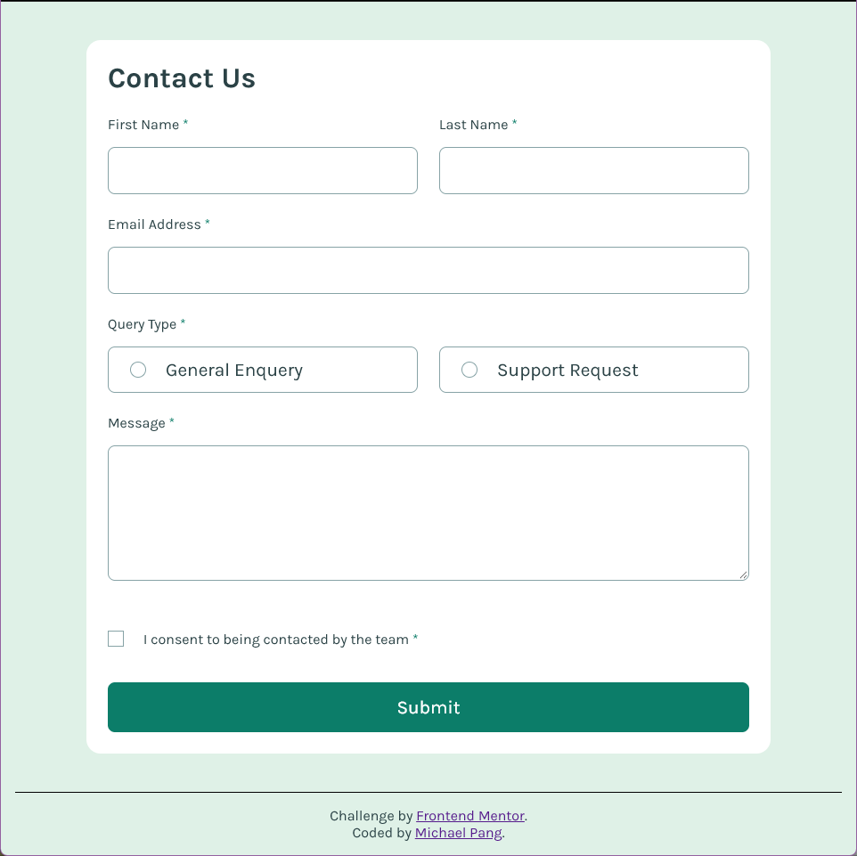

# Frontend Mentor - Contact form solution

This is a solution to the [Contact form challenge on Frontend Mentor](https://www.frontendmentor.io/challenges/contact-form--G-hYlqKJj). Frontend Mentor challenges help you improve your coding skills by building realistic projects. 

## Table of contents

- [Frontend Mentor - Contact form solution](#frontend-mentor---contact-form-solution)
  - [Table of contents](#table-of-contents)
  - [Overview](#overview)
    - [The challenge](#the-challenge)
    - [Screenshot](#screenshot)
    - [Links](#links)
  - [My process](#my-process)
    - [Built with](#built-with)
    - [What I learned](#what-i-learned)
    - [Continued development](#continued-development)
  - [Author](#author)

## Overview

### The challenge

Users should be able to:

- Complete the form and see a success toast message upon successful submission
- Receive form validation messages if:
  - A required field has been missed
  - The email address is not formatted correctly
- Complete the form only using their keyboard
- Have inputs, error messages, and the success message announced on their screen reader
- View the optimal layout for the interface depending on their device's screen size
- See hover and focus states for all interactive elements on the page

### Screenshot



### Links

- Solution URL: [https://github.com/pangm1/FrontEndMentor-Contact-Form_pangm1](https://github.com/pangm1/FrontEndMentor-Contact-Form_pangm1)
- Live Site URL: [https://frontendnentor-contact-formpangm1.vercel.app](https://frontendnentor-contact-formpangm1.vercel.app)

## My process

### Built with

- Semantic HTML5 markup
- CSS custom properties
- Flexbox
- CSS Grid
- Mobile-first workflow
- Vanilla Javascipt
- WAI-ARIA

### What I learned

I learned a lot about how to implement accessibility and tailor the form to specific users using screenreaders, keyboard-only, and different media types.

Starting with the HTML:

- the functionality of the ```autocomplete``` attribute in forms
- how to hide elements to sighted and/or screenreader users using hidden class and ```aria-hidden```
- how to get screenreaders to read the text of another element using ```aria-describedby```
- functionality of ```role='alert'```, especially the time and order in which elements are read out in a screenreader

Then with the CSS:

- creating a class to hide elements from sighted users
- styling elements that have ```appearance```, such as ```<input>```, ```<button>```, ```<fieldset>```, and ```textarea```
- controlling the size of ```<textarea>```
- using ```-inline``` and ```-block``` for layout
- styling radio and checkbox controls so the ```<label>``` and ```<input>``` together appear as one element
- replacing the standard appearance of radio and checkbox chosen states to replace with icons
- using ```:has``` to style elements based on the state of their children
- laying out the elements in a grid
- creating a pop-up

Javascript:

- using ```document.forms``` and ```FormData```
- toggling and removing classes and attributes
- using ```role='alert'``` to trigger alerts
- how to make new events by creating a ```CustomEvent```, passing custom data, and dispatching events
- creating, populating, and clearing elements

Here are some problems I ran across:

- The label and inputs of the radio and checkbox controls had to be able to turn on when I clicked on any part of the box. I had to use relative positioning to align the label text and input.
- When I used ```role='alert'``` on the labels and error text, the screenreader would announce them in a random order, and some not even at all, I fixed this using a single element (the error list) to announce all of the errors.
- I wanted to make a system to use the in-built event system to check validation easily. However, thrown errors do not return to where events are dispatched, so I had to write a wrapper to pass in the checks. I used the ```details``` field of the ```CustomEvent``` interface to pass the elements that I needed to change. (look inside the forEach loop in ```submitForm```, then ```validateInput``` and the ```/* validation */``` section in the js file)

### Continued development

I want to be able to implement whatever I learned about accessibility into my workflow seamlessly without having to create it from scratch every time. Then I would be able to incorporate these techniques when I use web frameworks.

## Author

- Frontend Mentor - [@pangm1](https://www.frontendmentor.io/profile/pangm1)